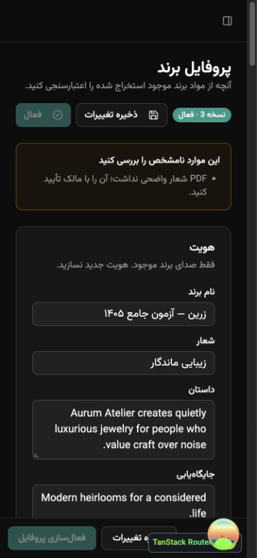
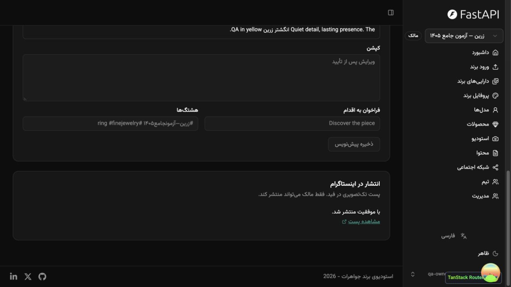

# گزارش آزمون جامع MVP1 — ۲۰۲۶/۱۱/۰۱

نتیجه: معیارهای MVP1 در محیط محلیِ مجزا با سرویس‌های آزمایشی تأیید شدند. دو ایراد رفتاری در استخراج PDF و نمایش نتیجهٔ انتشار صفی پیدا، بازتولید و اصلاح شد. مشکلات برچسب‌گذاری فرم، ترجمه و استقلال تست‌ها نیز اصلاح شدند.

این نتیجه، تأیید عملکرد اتصال واقعی به سرویس‌های تجاری نیست؛ حدود آزمون در انتهای گزارش آمده است.

## محیط و حفاظت از داده‌ها

| جزء | محیط آزمون |
| --- | --- |
| رابط کاربری | `http://localhost:5180`، کد همین workspace |
| API | `http://localhost:8010` |
| PostgreSQL 18 | کانتینر مستقل `gold-qa-20261101-db` روی `127.0.0.1:5544` |
| دیتابیس مرورگر و آزمون زنده | `gold_qa` |
| دیتابیس تست‌های بک‌اند | `gold_qa_unit`؛ جدا به دلیل پاک‌سازی کاربران در teardown تست‌ها |
| صندوق ایمیل | کانتینر مستقل `gold-qa-20261101-mail`؛ وب روی 8125 و SMTP روی 1125 |
| صف | Redis مجزا روی `127.0.0.1:6389` |
| worker | دقیقاً یک پردازش از `app.workers.tasks.WorkerSettings` |
| ذخیره‌سازی | پوشهٔ خصوصی آزمون در `/private/tmp/gold-qa-20261101/storage` |
| AI / Instagram | هر دو `fake`؛ OCR خارجی غیرفعال |
| اجرای job | ابتدا پردازش فوری؛ سپس `TASKS_EAGER=false` با صف و worker واقعی |

داده‌های محیط اصلی روی پورت‌های 5173/8000 و دیتابیس اصلی تغییر داده نشدند. هیچ کلید واقعی خوانده یا در گزارش ثبت نشد. کاربران، برندها، توکن اتصال و فایل‌های این آزمون مخصوص QA هستند. هیچ درخواست تولید پولی یا انتشار واقعی انجام نشد.

## نتایج نهایی

| بررسی | نتیجه | شاهد |
| --- | --- | --- |
| همهٔ تست‌های بک‌اند | **166 passed**، بدون شکست | `backend-final.log`؛ حدود 10.6 ثانیه |
| همهٔ تست‌های Playwright با worker واقعی | **65 passed**، بدون شکست | `e2e-final.log`؛ حدود 1.2 دقیقه |
| بررسی‌های زندهٔ API و worker | **27 passed** | `live-checks.json` |
| مهاجرت دیتابیس تازه | موفق تا `f1eb7aefef7a` | هر دو دیتابیس QA از صفر ساخته شدند |
| Ruff | موفق | `All checks passed!` |
| mypy | موفق | بدون ایراد در 63 فایل منبع |
| Biome | موفق | بررسی 104 فایل؛ بدون تغییر خودکار در اجرای check |
| TypeScript و production build | موفق | `bun run build` |
| نمایش موبایل فارسی | 10 صفحه بدون سرریز افقی در 390×844 | `mobile-audit.json` |
| برچسب‌های فرم پروفایل | صفر input/textarea بدون برچسب | بررسی DOM در مرورگر |
| بارگذاری نهایی صفحهٔ انتشار | بدون خطا یا هشدار جدید کنسول | بارگذاری تمیز پس از پایان ویرایش‌ها |

جمع شمارش تست‌های خودکار و بررسی‌های زنده: **258**. بررسی‌های بصری و واکنش‌گرایی جدا از این شمارش‌اند. این عدد، درصد پوشش کد نیست.

## پوشش سناریوها

### حساب کاربری و مدیریت

- ثبت‌نام معتبر، ایمیل نامعتبر و تکراری، گذرواژهٔ ضعیف، عدم تطابق تأیید و فیلدهای خالی.
- ورود صحیح و ناموفق، خروج، جلوگیری از ورود به صفحات محافظت‌شده با توکن نامعتبر.
- بازیابی گذرواژه از ایمیل دریافت‌شده در Mailpit، لینک نامعتبر و گذرواژهٔ جدید ضعیف.
- ویرایش نام و ایمیل، انصراف از ویرایش و تغییر گذرواژه.
- ساخت، ویرایش و حذف کاربر آزمایشی در مدیریت؛ جلوگیری از ورود کاربر عادی به مدیریت.
- ساخت، ویرایش، حذف و حالت خالی Items قالب.
- تغییر پوسته و ماندگاری انتخاب آن.

### برند، تیم و مرز دسترسی

- ساخت برند، نام فارسی و انتخاب workspace.
- اضافه‌کردن عضو و نقش Content Manager، محدودیت مدیریت اعضا و حفظ حداقل یک Owner.
- عدم دسترسی کاربر نامرتبط و عدم عبور superuser از مرز برند بدون عضویت.
- بررسی زندهٔ 15 مسیر برند با کاربر نامرتبط؛ همه 404 برگشتند.
- مدیر محتوا اجازهٔ آماده‌سازی محصول و محتوا دارد، اما تأیید، رد، انتشار، مدیریت تیم، اتصال اجتماعی و فعال‌سازی پروفایل برای او رد می‌شود.
- درخواست بدون احراز هویت رد شد؛ CORS برای origin نامعتبر مجوز بازگشت نداد؛ هدرهای `nosniff` و `DENY` موجود بودند.

### فایل‌ها و کتاب برند

- آپلود ترکیبی PDF، PNG، SVG و TTF از خود رابط کاربری.
- ZIP با پوشه‌های داخلی و فایل EPS؛ سه فایل معتبر استخراج و پردازش شدند.
- رد تصویر جعلی و ZIP دارای `../` در API زنده، بدون ذخیرهٔ asset.
- تست خودکار محدودیت تعداد و اندازه، ناسازگاری MIME/پسوند و امضای فایل، ZIP تو‌در‌تو، symlink و محدودیت استخراج.
- پاک‌سازی SVG از script، event handler، ارجاع خارجی، data URI و style؛ رد DTD/entity.
- دریافت asset خصوصی، دانلود توسط عضو مجاز و رد کاربر نامرتبط.
- استخراج متن PDF غنی: داستان، جایگاه‌یابی، مخاطب، شخصیت، لحن، نور، پس‌زمینه، ترکیب‌بندی، رنگ، فونت، مدل انسانی، قواعد اجتماعی، بایدها و نبایدها.
- نگهداری بخش‌های Packaging و Sustainability و provenance صفحه.
- PDF بدون متن، هشدار نیاز به OCR می‌دهد. آزمون fallback OCR و cache با پاسخ mock اجرا شد.

### پروفایل، مدل و محصول

- اعتبارسنجی ساختار پروفایل و رد اصلاح نامعتبر.
- ویرایش دادهٔ استخراج‌شده، ذخیره، reload و بررسی ماندگاری مقادیر فارسی و فهرستی.
- فعال‌سازی فقط توسط Owner؛ آرشیو پروفایل فعال قبلی و جلوگیری از فعال‌سازی پروفایل برند دیگر.
- مدل مجازی با سه preview، یک تصویر canonical و انتخاب default.
- مدل واقعی: نیاز به reference و رضایت ثبت‌شده قبل از آماده/پیش‌فرض شدن.
- حفظ تنها یک مدل پیش‌فرض و جداسازی مدل‌ها میان برندها.
- نام، دسته، SKU، نوع و رنگ فلز، سنگ، توضیح و integrity notes محصول.
- دو تصویر منبع، تغییر تصویر اصلی و تنها یک primary؛ کیفیت پایین به‌صورت هشدار مشورتی.
- الزام تصویر منبع و پروفایل فعال برای تولید، و محدودیت نوع تصویر محصول.

### تولید، اصالت، کپشن و تأیید

- سه حالت `studio`، `on_model` و `campaign` در API زنده با صف و worker واقعی.
- نسبت‌های 1:1، 4:5 و 16:9، مدل آماده برای on-model و نگهداری پارامترهای درخواست.
- مشاهدهٔ `queued` در پاسخ اولیه و سپس `completed` همراه تصویر و نتیجهٔ اصالت.
- حالت‌های passed، needs_review و failed و رد تأیید/انتشار تصویر نامعتبر در تست‌های بک‌اند.
- شکست تولید و retry، و خروجی نامعتبر provider با fake/mock.
- کپشن اصلی، دو گزینهٔ جایگزین، CTA و هشتگ.
- حفظ ویرایش دستی: درخواست بازتولید بدون force با 409 رد شد و متن باقی ماند.
- ارسال برای تأیید، نیاز به کپشن، ثبت approved_by و approved_at.
- ویرایش پس از تأیید، مجوز قبلی را باطل می‌کند و انتشار تا تأیید مجدد رد می‌شود.

### انتشار

- اتصال آزمایشی Instagram بدون بازگرداندن access token در پاسخ.
- انتشار فقط پس از تأیید Owner؛ محدودیت حساب قطع‌شده و integrity ناموفق.
- job واقعی در Redis، مصرف توسط یک worker و انتشار توسط fake adapter.
- فقط یک تلاش موفق؛ کلیک/درخواست تکراری همان job را برمی‌گرداند.
- ممنوعیت ویرایش محتوای منتشرشده.
- شکست و retry انتشار در تست‌های بک‌اند.
- آزمون دستی کنترل‌شده: توقف کوتاه worker، ارسال از UI، مشاهدهٔ دکمهٔ غیرفعال «در حال انتشار»، ادامهٔ worker و تغییر خودکار صفحه به «منتشرشده» بدون reload.

### زبان و موبایل

- English/Farsi، ماندگاری زبان پس از reload، `lang=fa` و `dir=rtl` و بارگذاری Vazirmatn محلی.
- تاریخ فارسی و حفظ متن واردشدهٔ کاربر در زبان اصلی.
- بررسی ده صفحهٔ اصلی در عرض 390 پیکسل: Import، Assets، Profile، Models، Products، Studio، Content، Social، Team و Admin؛ هیچ‌کدام اسکرول افقی در سطح document نداشتند.
- بازشدن کشوی موبایل، جابه‌جایی زبان و برچسب فارسی کشو.
- دسترسی به فیلدهای فهرستی پروفایل با label و اتصال متن راهنما به textarea.

## ایرادهای پیدا و اصلاح‌شده

| مورد | بازتولید قبل از اصلاح | اصلاح و تأیید |
| --- | --- | --- |
| نبایدهای PDF گم می‌شد | عنوان `DON’TS` پس از استخراج PDF به additional_sections می‌رفت و donts خالی بود؛ سه تست regression شکست خوردند | یکسان‌سازی آپاستروف در شناسایی عنوان؛ سه حالت نوشتاری و مسیر واقعی PDF موفق شدند |
| نتیجهٔ انتشار صفی روی UI نمی‌آمد | E2E با worker واقعی با وضعیت Approved متوقف می‌شد، با وجود پایان job در سرور | polling فقط برای jobهای فعال، refresh پیش‌نویس پس از پایان، پیام صف و غیرفعال‌شدن دکمه؛ E2E و آزمون توقف/ادامهٔ worker موفق شدند |
| فیلدهای فهرستی label قابل‌دسترسی نداشتند | Audience و سایر فهرست‌ها در snapshot به‌صورت textbox بدون نام بودند | `useId`، `htmlFor` و `aria-describedby`؛ صفر کادر متنی بدون نام در پروفایل و آزمون ذخیره/بازیابی Audience |
| ترجمه‌های جاافتاده | Section title و عنوان/شرح کشوی موبایل انگلیسی بودند | اتصال به ترجمه‌های فارسی؛ بررسی مجدد در مرورگر |
| تست فارسی به دادهٔ قبلی وابسته بود | در دیتابیس تازه، صفحهٔ NoBrand به‌جای Import دیده می‌شد | تست خودش برند می‌سازد؛ هیچ assertion قبلی حذف نشد |
| lint فایل‌های خروجی تست را بررسی می‌کرد | JSONهای session و last-run تولیدشده باعث شکست formatter می‌شدند | حذف artifactهای تولیدشده از دامنهٔ Biome؛ کد منبع و تست‌ها همچنان بررسی می‌شوند |

OpenAPI تغییر نکرد؛ بازتولید client لازم نبود. تاریخچهٔ منتشرشده بازنویسی نشد.

## شواهد تصویری

نمایش فارسی پروفایل روی موبایل:

نتیجهٔ انتشار صفی در رابط فارسی:

## فایل‌های نتیجهٔ محلی

- گزارش HTML مرورگر: `frontend/playwright-report/index.html`.
- پوشهٔ اجرا و لاگ‌ها: `/private/tmp/gold-qa-20261101/results/`.
- فایل‌های مهم: `backend-final.log`، `backend.xml`، `e2e-final.log`، `live-checks.json`، `mobile-audit.json` و `frontend-build-final.log`.
- harness موقت و تنظیمات غیرتجاری QA خارج از مخزن و زیر `/private/tmp/gold-qa-20261101/` هستند؛ فایل‌های موقت ممکن است پس از راه‌اندازی مجدد سیستم پاک شوند.

## حدود نتیجه و موارد باقی‌مانده

- مدل AI پولی، OCR خارجی واقعی، Instagram Graph و S3 زنده فراخوانی نشدند. رفتار adapterها با fake/mock بررسی شد؛ کیفیت تصویر واقعی AI و مجوزهای واقعی Meta از این گزارش قابل استنتاج نیست.
- اجرای خودکار مرورگر با Chromium بود. Safari/WebKit، Firefox و دستگاه فیزیکی موبایل اجرا نشدند؛ بررسی موبایل با viewport انجام شد.
- بررسی امنیت شامل مرزهای دسترسی و بردارهای آپلود موجود در تست‌هاست؛ آزمون نفوذ جامع یا آزمون بار نیست.
- بک‌اند 55 هشدار deprecation دارد: استفادهٔ TestClient از httpx و `Pillow.getdata`. تست‌ها موفق‌اند؛ رفع سازگاری نسخه‌های آینده جدا از این مرحله است.
- در طول تغییر ترجمه‌ها، HMR موقتاً خطای context تولید کرد؛ پس از reload تمیز، صفحهٔ نهایی بدون خطا/هشدار جدید بارگذاری شد. تست نهایی با صفحات تازه موفق بود.
- این مرحله استقرار production انجام نداد. محیط QA برای بازبینی محلی باقی مانده است.
